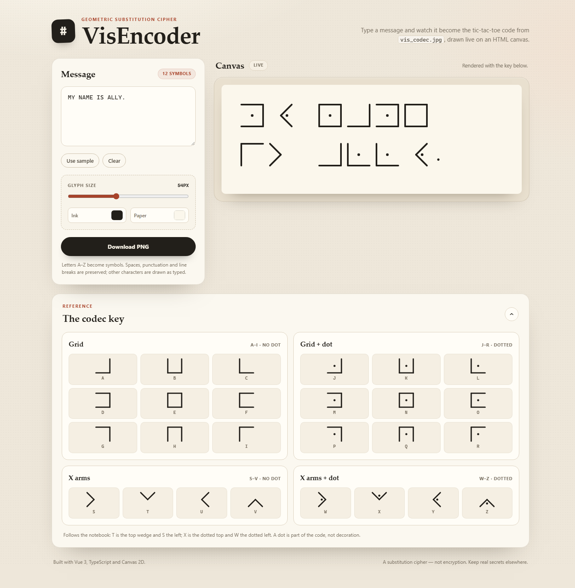

# VisEncoder

A Vue 3 + TypeScript front end that renders text in the handwritten geometric cipher from [`vis_codec.jpg`](./vis_codec.jpg) on an HTML canvas.



## Run it

```bash
npm install
npm run dev      # local dev server
npm test         # Vitest suite for the codec and layout
npm run build    # type-check + production build
npm run preview  # serve the production build
```

## The codec in the notebook

Letters are written as fragments of a tic-tac-toe grid and of an X.

### Grid A–I

Each glyph is made of the cell sides that face the centre of the grid (the shape opens away from the centre):

| Cell | Letter | Sides | Shape |
| --- | --- | --- | --- |
| top-left | A | bottom + right | `⌟` |
| top-middle | B | bottom + left + right | `⊔` |
| top-right | C | bottom + left | `⌞` |
| middle-left | D | top + bottom + right | `]` |
| centre | E | all four | `□` |
| middle-right | F | top + bottom + left | `[` |
| bottom-left | G | top + right | `⌝` |
| bottom-middle | H | top + left + right | `⊓` |
| bottom-right | I | top + left | `⌜` |

**J–R** use the same nine shapes as A–I with a dot in the middle.

### X arms

The sheet labels the wedges like this, which is the mapping implemented here:

| Wedge | Plain | Dotted | Shape |
| --- | --- | --- | --- |
| top | T | X | two upper arms, opening up |
| left | S | W | two left arms, opening left |
| right | U | Y | two right arms, opening right |
| bottom | V | Z | two lower arms, opening down |

Dots sit inside the corresponding wedge. The variant matters: many published pigpen keys swap S/T and W/X, but the notebook's sample (`MY NAME IS ALLY.`) confirms S is the left wedge and Y is the right one.

### Input normalization

German umlauts are transliterated before encoding: **ä → ae, ö → oe, ü → ue** (any case). The sharp s follows the same German spelling rule: **ß → ss** (and ẞ → SS). Everything outside A–Z is drawn as typed.

The app's default message is that sample line.

## Implementation

- `src/lib/codec.ts` — every letter maps to line segments and an optional dot in a normalized 0…1 square, plus the text-to-token encoder.
- `src/lib/layout.ts` — greedy word wrapping with a fallback break for words wider than the sheet; punctuation and characters outside A–Z are measured and drawn as text.
- `src/lib/render.ts` — Canvas 2D drawing with device-pixel-ratio-aware sizing, round ink strokes and dots.
- `src/components/CipherCanvas.vue` — the live canvas, resize handling and PNG download. It exposes `downloadPNG()`.
- `src/components/CodecKey.vue` + `GlyphMark.vue` — the reference key, drawn with the same glyph code as the canvas.
- `src/App.vue` — composer, glyph-size and colour controls, export, and key.

Text is case-folded; spaces and line breaks are preserved. This is a substitution cipher for fun, not encryption.
